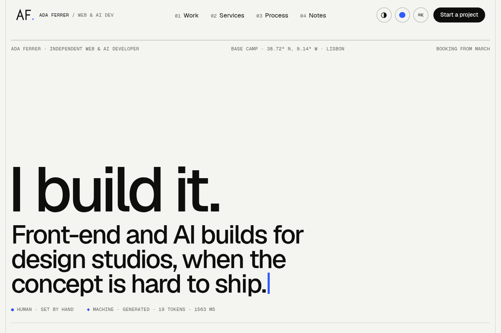

# Contour

A one-page portfolio for a freelance developer or a small studio that builds websites and AI features for agencies. Blueprint look: warm off-white paper, ink type, one cobalt accent, mono labels and a layout grid you can switch on. Motion runs on GSAP with ScrollTrigger and SplitText plus Lenis smooth scrolling, all bundled. The demo developer, Ada Ferrer, her clients, projects and notes are fictional.



Demo: https://contour.formgong.com

## Install

As a Hugo module:

```sh
hugo mod init example.com/site
```

```toml
# hugo.toml
[module]
  [[module.imports]]
    path = "github.com/formgong-hq/contour-hugo-theme"
```

Or as a git submodule:

```sh
git submodule add https://github.com/formgong-hq/contour-hugo-theme.git themes/contour
echo 'theme = "contour"' >> hugo.toml
```

Every text of the page lives in `data/content.json`. Copy `exampleSite/data/content.json` into your site's `data/` folder and edit it there; without it the theme uses its own copy.

Hugo 0.156.0 or newer, no npm packages and no Hugo extended needed. Posts, tags, categories and the RSS feed use the theme's list and single layouts.

## Run the example site

```sh
cd exampleSite
hugo server --themesDir ../..
```

## Contact form

The contact form posts to Formgong (free plan): put your access key in `form.access_key` in `data/content.json`. To send it anywhere else, change `params.formAction` in `hugo.toml`.

## Fonts

Geist, Geist Mono: bundled as WOFF2 files (Latin and Latin Extended), no requests to Google Fonts. SIL Open Font License 1.1, the licence texts are next to the font files.

## License

MIT
